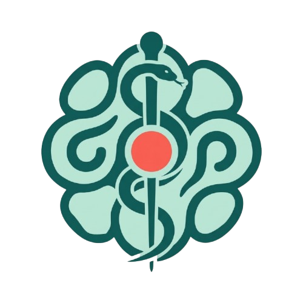
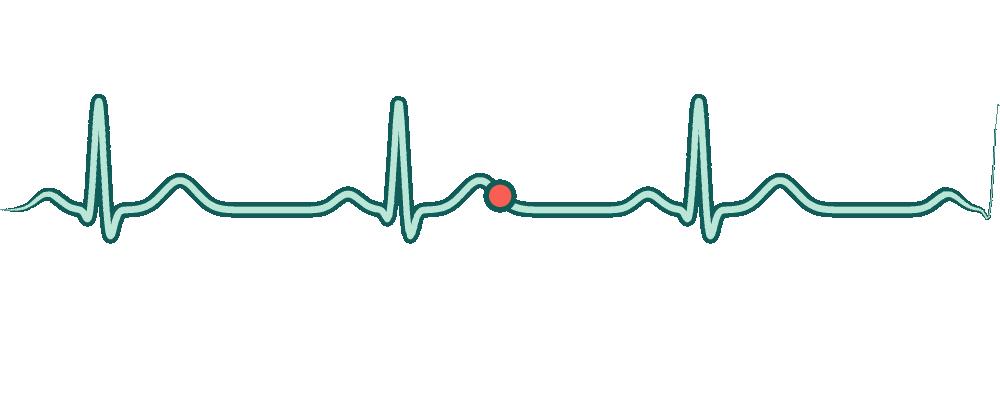

  
  

### O que é?

Um sistema intuitivo alimentado por IA (DeepSeek) que tem como objetivo servir como "recepcionista" de hospitais, guiando os pacientes de acordo com suas necessidades.

* `Trabalho Escolar`

EREM Professor Manoel Edmundo 

### License 
Esse projeto é licenciado pela [MIT LICENSE](LICENSE).

### Participantes

Ketylen Victória 

José Arthur 

Karen Mariany

Maria Daniela

Emanuela Aparecida 

Franciely Farias

Laisa Da Silva

Ana Clara 

Sabrina Maria 

Vitória Kauane

#### Desenvolvedores:

{DAVIDVS-PR1MVS}.[https://github.com/DAVIDVS-PR1MVS]

DeByel